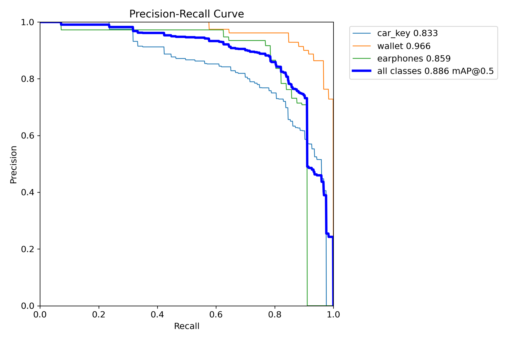
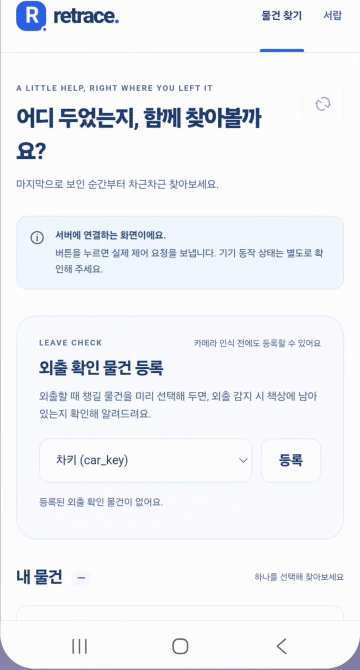
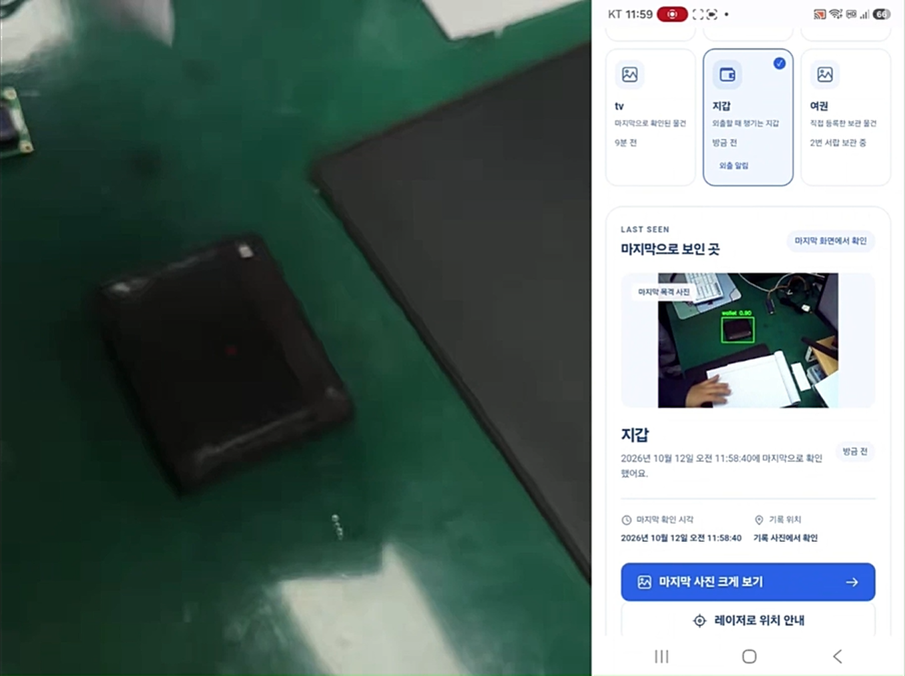

# Project-Retrace

**카메라의 마지막 목격 기록과 연동 장치로 물건 찾기와 외출 준비를 돕는 스마트 공간 시스템**

| 기간 | 인원 |
|---|---|
| 2026.10.06 ~ 2026.10.12 | 2인 팀 |

## 1. 프로젝트 개요

Retrace는 차키, 지갑, 이어폰처럼 자주 쓰는 물건을 어디에 두었는지 기억하기 어려운 상황에서 출발했습니다. Jetson Nano가 카메라 영상에서 물건을 인식해 마지막으로 관찰한 사진과 시각을 기록합니다. 사용자는 웹에서 기록을 확인하고 레이저로 위치 안내를 요청할 수 있습니다. 외출할 때는 등록한 준비물이 책상 카메라에 계속 보이는지 확인해 휴대폰 알림과 현관등으로 알려줍니다.

### 팀과 역할

| 이름 | 역할 |
|---|---|
| Gabin (`dev-gabin`) | **AI 비전** — YOLO 모델 전이 학습 및 카메라 객체 인식 구현<br>**임베디드** — STM32 메인 유닛의 USB Serial·Pan/Tilt 서보·레이저·PIR 제어, ESP32 현관등의 자동 점등·Wi-Fi TCP·경고 명령 처리, ESP32-C3 LCD의 최근 목격 기록·외출 준비물·날씨 표시 구현<br>**시스템 설계** — 아이디어 제안, 시스템 구조 설계, Git 관리 |
| Eunpyo Jun (`JuEuPy`) | **시스템 구축** — Jetson Nano 환경 구성, 하드웨어 조립과 회로 구성, MariaDB 구축<br>**장치 연동** — 서버·장치 통신 및 웹 연동, 레이저 모듈 구현과 좌표 보정 |

통합 테스트와 발표자료 준비는 함께 진행했습니다.

## 2. 시스템 구성

| 구성 | 연결과 역할 |
|---|---|
| USB 웹캠 → Jetson Nano | OpenCV로 영상을 받아 YOLO로 물건을 탐지하고 마지막 목격 기록을 갱신 |
| 웹 브라우저 ↔ Jetson Nano | HTTP로 마지막 사진과 시각을 조회하고 레이저·서랍 동작을 요청하거나 외출 준비물 목록을 관리 |
| STM32 메인 유닛 ↔ Jetson Nano | USB Serial로 PIR 이벤트와 Pan/Tilt·레이저 제어 명령을 전달 |
| STM32 스마트 서랍 ↔ Jetson Nano | HC-06과 Bluetooth RFCOMM으로 서랍 열기 요청과 SOS 이벤트를 전달 |
| ESP32 현관등 ↔ Jetson Nano | Wi-Fi TCP로 현관 PIR 이벤트와 현관등 경고 명령을 전달 |
| Jetson HTTP API → ESP32-C3 → I2C LCD | 최근 목격 기록과 준비물 목록을 조회해 시각·날씨와 함께 표시 |
| Jetson Nano → ntfy → 휴대폰 | 외출 준비물 확인 결과와 SOS 알림을 전달 |

장치별 배선과 메시지 형식은 아래 문서에 정리했습니다. [보드 핀맵](./docs/pinmap.md) · [통신 프로토콜](./docs/protocol.md)

## 3. 사용 기술

| 분야 | 기술 |
|---|---|
| 영상·객체 탐지 | Python, Ultralytics YOLO, OpenCV, Jetson Nano |
| 서버·저장 | C TCP 서버, MariaDB Connector/C, JPEG, HTTP API |
| 임베디드 | STM32 NUCLEO-F411RE, STM32CubeMX, HAL, CMake, ESP32, PlatformIO |
| 센서·구동 | PIR 센서, Pan/Tilt 서보, 레이저, PCA9685, I2C 1602 LCD |
| 통신·웹 | USB Serial, Bluetooth Classic RFCOMM, Wi-Fi TCP, HTTP, I2C, HTML/CSS/JavaScript |
| 알림·날씨 | ntfy, Open-Meteo |

## 4. 데이터와 모델

- **객체 탐지 모델** — COCO 기본 80개 클래스에 `car_key`, `wallet`, `earphones`를 추가한 83개 클래스 YOLO 모델을 사용했습니다. `person` 클래스는 탐지할 수 있으며 물건의 마지막 목격 기록에서는 제외합니다.
- **학습 데이터** — 추가 클래스 데이터의 출처, 이미지 수, 학습·검증 분할은 확인이 필요합니다. 학습 데이터와 모델 가중치는 공개 저장소에 포함하지 않습니다.
- **마지막 목격 기록** — 사진은 JPEG로 저장합니다. 물건 종류, 관찰 시각, 사진 경로, 레이저 안내에 사용하는 카메라 좌표는 MariaDB에 기록합니다.

## 5. 동작 방식

1. **마지막 목격 기록** — 책상 쪽 PIR 센서가 움직임을 감지하면 Jetson Nano가 YOLO 추론을 시작합니다. 탐지 점수가 기준을 충족하고 연속 프레임에서 물건의 위치가 안정적이면 사진과 시각을 갱신합니다.
2. **물건 찾기** — 사용자가 웹에서 물건을 검색하면 마지막 사진과 시각을 볼 수 있습니다. 레이저 안내를 요청하면 Jetson Nano가 저장된 카메라 좌표를 보정된 서보 각도로 변환해 STM32에 보냅니다. 서랍에 등록한 물건은 웹에서 해당 서랍을 열도록 요청할 수 있습니다.
3. **외출 준비물 확인** — 현관 PIR 이벤트가 들어오면 책상 카메라 영상에서 등록한 준비물이 계속 보이는지 약 3초간 재확인합니다. 준비물이 반복해서 탐지되면 휴대폰과 현관등으로 경고합니다.
4. **LCD와 SOS** — ESP32-C3가 최근 목격 기록과 준비물 목록을 조회해 시각·날씨와 함께 LCD에 표시합니다. 스마트 서랍의 SOS 버튼을 누르면 휴대폰 찾기 알림을 보냅니다.

## 6. 실행 방법

1. Jetson Nano에서 CUDA를 지원하는 PyTorch와 OpenCV 환경을 준비하고, `jetson_nano/requirements.txt`의 추가 패키지를 설치합니다. [개발 환경 안내](./docs/environment.md)
2. 사용할 YOLO 모델 가중치를 프로젝트에서 지정한 경로에 배치합니다. [추론 설정과 모델 경로](./docs/inference_policy.md)
3. MariaDB와 C TCP 서버를 설정하고 실행합니다. 실제 계정 정보와 장치별 네트워크 설정은 로컬 파일에 보관합니다. [Jetson 서버·DB 실행 안내](./jetson_nano/server_jetson/README.md)
4. 핀맵에 따라 장치를 연결하고 STM32·ESP32 펌웨어를 준비합니다. [보드 핀맵](./docs/pinmap.md)
5. 프로젝트 루트에서 Jetson 앱을 실행한 뒤 웹 화면을 엽니다. [웹 실행·연동 안내](./web/README.md)

```bash
python jetson_nano/main.py
```

### 프로젝트 구조

```text
Project-Retrace/
├── stm32/
│   ├── main_unit/            # USB Serial, Pan/Tilt, 레이저, PIR
│   └── drawer/               # 스마트 서랍, LED, SOS
├── esp32/
│   ├── entrance_node/        # 현관 PIR, 센서등, Wi-Fi TCP
│   └── preparation_display/ # 준비물·최근 목격 기록·날씨 LCD
├── jetson_nano/
│   ├── main.py               # Jetson 앱 실행 진입점
│   ├── vision/               # 객체 탐지, 좌표 변환, 외출 재확인
│   ├── record/               # 마지막 목격 기록, 준비물·서랍 정보
│   ├── communication/        # USB Serial, TCP 이벤트, ntfy 알림
│   ├── client/               # TCP와 Bluetooth RFCOMM 중계
│   ├── server_jetson/        # C TCP 서버, MariaDB 연동
│   └── calibration/          # 레이저 좌표 보정
├── web/                      # 물건 조회·장치 제어 화면
├── docs/                     # 핀맵, 프로토콜, 환경, 평가 자료
└── README.md
```

## 7. 모델 성능 평가

학습에 사용하지 않은 테스트 이미지 155장(객체 238개)에서 **mAP@50 88.6%, mAP@50–95 62.1%**를 기록했습니다.



클래스별 AP@50은 지갑 96.6%, 이어폰 85.9%, 차키 83.3%였습니다. 세 클래스 중 지갑이 가장 높았고 차키가 가장 낮았습니다.

## 8. 결과

### 모바일 웹 화면 시연



모바일 웹에서 물건을 검색하고 마지막으로 관찰한 사진과 시각을 확인합니다. 같은 화면에서 레이저 위치 안내와 스마트 서랍 열기를 요청하고 외출 준비물 목록을 관리할 수 있습니다.

### 지갑 위치 안내



왼쪽은 실제 지갑이고, 오른쪽은 모바일 웹에 표시된 마지막 목격 사진과 시각, 레이저 위치 안내 버튼입니다. 기록 이후 지갑이 이동했다면 사진 속 위치와 현재 위치가 다를 수 있습니다.

## 9. 시행착오와 해결

| 문제 | 원인 | 해결 |
|---|---|---|
| 레이저 안내에 사용할 서보 각도를 정하기 어려웠음 | 같은 카메라 좌표라도 카메라와 레이저의 설치 위치, 물건을 관찰하는 평면에 따라 필요한 각도가 달라짐 | 설치 환경에서 카메라 좌표와 서보 각도를 보정하고, 장치 위치나 관측 평면이 바뀌면 다시 보정 |
| LCD가 새 정보를 가져오지 못했을 때 표시를 유지해야 했음 | Wi-Fi 연결이나 HTTP 요청이 실패하면 표시할 새 데이터가 들어오지 않음 | 마지막으로 받아온 정보를 계속 표시하고, 캐시된 정보나 오프라인 상태임을 화면에 표시 |
| 한 프레임만으로 마지막 목격 위치를 확정하기 어려웠음 | 같은 물건을 비추고 있어도 탐지 중심점이 프레임마다 흔들릴 수 있음 | 탐지 점수와 연속 프레임 사이의 위치 차이를 함께 검사하고, 두 조건을 충족했을 때 기록을 갱신 |

## 10. 배운 점

### AI 비전

COCO 사전학습 YOLO 모델에 차키·지갑·이어폰을 추가 학습했습니다. 학습에 사용하지 않은 이미지에서 클래스별 AP와 재현율을 비교하며 어떤 물건을 탐지하기 어려웠는지 확인하는 방법을 배웠습니다.

### 임베디드 시스템

STM32에서 USB Serial로 받은 명령을 해석해 Pan/Tilt 서보와 레이저를 제어하는 펌웨어를 작성했습니다. ESP32 현관등과 ESP32-C3 LCD를 구현하면서, PIR 센서 이벤트에 반응하는 동작과 주기적으로 데이터를 조회해 화면을 갱신하는 동작을 각각 설계하는 방법을 익혔습니다.

### 시스템 연동

카메라의 탐지 결과가 마지막 목격 기록으로 저장되고, 웹 조회와 레이저 위치 안내에 사용되는 흐름을 통합 테스트했습니다. 카메라 좌표로 실제 물건의 위치를 가리키려면 카메라와 레이저의 설치 위치를 반영해 서보 각도를 보정해야 한다는 점을 배웠습니다.
